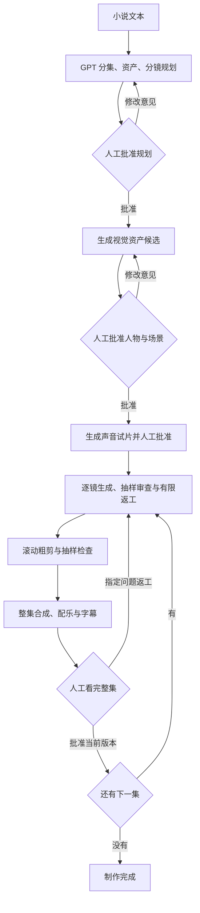

# Norlan 的执行与审批

Norlan 是运行在本机的 Python 程序。GPT 负责结构化规划、提示词调整和抽样画面诊断；官方媒体接口生成素材；FFmpeg 执行确定性的抽帧、拼接、字幕和混音。终端对话与本地审片页面共享同一份状态，页面不是另一套自动化流程。

## 从小说到逐集交付

没有声音资产的无对白项目无需声音试片。涉及对白时，默认要求镜头引用已批准的声音资产。规划生成与付费制作分开：批准某集意味着允许进入下一集，程序不会在上一集等待审批时预生成后续集。

## 模块边界

| 模块 | 职责 |
| --- | --- |
| `core.py` | 原子状态写入、文件哈希、版本审批、依赖失效、预算账本与进程锁。 |
| `brain.py` | Codex CLI / OpenAI API 调用、结构化输出校验、小说规划、提示词细化、抽样画面审查及对话意图。 |
| `providers.py` | Ark 图片与视频接口、参考素材编码、视频任务查询及下载。 |
| `music.py` | 火山独立纯音乐接口的签名、提交、查询及下载。 |
| `transcription.py` | 从实际音轨取得自动识别文本和时间戳，不使用剧本冒充转写。 |
| `media.py` | 本地 FFmpeg 操作、证据提取、顺序拼接、配乐混音及字幕渲染。 |
| `pipeline.py` | 恢复制作、推进到下一审批点、镜头重试、粗剪和整集交付。 |
| `dashboard.py` | 仅本机访问的审片界面和操作入口。 |

程序不要求浏览器操纵即梦网页。默认 GPT 通过已有 Codex 登录；独立 OpenAI API 方式由用户显式选择并单独计费。用户的小说、意见和外部文本作为创作数据处理，不获得执行命令或改写审批规则的权力。

## 参考条件如何传递

规划里的 `asset_ids` 是镜头到角色、场景、道具或声音资产的绑定。视觉资产经过人工批准后，其真实文件会编码传入 Ark；不能只在提示词里写一个文件名就声称使用了参考图。

声音资产采用原生视频生成的短试片：先用已批准的角色视觉参考生成试音，再提取音轨供人工试听。后续含对白镜头引用已批准声音。视频适配器限制最多 9 张参考图、3 份声音参考，声音参考总计不超过 15 秒；超过限制会停止，不能悄悄删掉关键资产。

同场景续镜还包含前镜实际片尾附近采样画面。GPT 得到资产定义与版本、上一镜已观察末态、分镜意图和返工意见，然后细化下一镜提示词。原定对白作为约束再次附加。失败片段不作为下镜的固定设定；只有已接受的镜头可以推进。

人物身份设定和画面中的动态状态分开：衣服、角色外貌等来自批准资产；动作位置等来自已接受画面的观察。参考并不等于模型保证，特别是遮挡、复杂运动、多人对白和口型仍容易出错。

## 检查结果不是交付批准

| 结果 | 含义 |
| --- | --- |
| 生成完成 | 收到并保存文件，不能推出内容正确。 |
| `accepted` 镜头 | 抽样检查通过，或由人复核接受，可用于后续制作。 |
| `review_required` | 抽样不确定、失败且尝试耗尽，或粗剪诊断需要人工定位。 |
| `awaiting_review` 分集 | 整集已有成片，等待完整人工观看和听审。 |
| `approved` 分集 | 人批准当前版本与哈希，允许进入下一集。 |

每镜抽取首、中、片尾附近画面，并记录原视频 SHA-256。原音频另存为 WAV，但音频文件存在不表示 GPT 已经听过。检查记录明确保留 `audio_checked=false`、`whole_video_checked=false`；抽样通过不能覆盖片段中未采样部分。

滚动粗剪按 `batch_size` 触发。已有粗剪检查绑定所用镜头哈希，素材变化后旧结果不能替代新检查。当前自动返工针对明确失败的单镜；粗剪定位不清时停下来要求人工决定，不把整批好镜头盲目重做。

## 版本与返工

资产、镜头、成片都使用新的版本文件名。审批包含对象 ID 与当前版本，并核对文件哈希；页面过期、素材丢失或内容改变时不能批准旧结果。

指定镜头返工会使同场景依赖它的后续镜头失效。已生成的后续集会因前集变化而需要重新建立连续性。改变资产会使使用该资产的镜头及相关后续产物失效。旧文件与历史记录留作追溯，不会被新结果悄悄覆盖。

自动尝试上限包括最初生成和人工要求的后续返工，按每项资产或镜头累计。提出新修改不会清零次数；达到上限需要先重新评估，再显式调整限制。项目总预算和 GPT 调用次数上限同时生效。审批是对具体版本的决定，不是永久允许模型自行换角、改场景或批准之后所有集。

## 费用与恢复

`project.json` 中的每次调用先写入 `reserved`，随后才发送请求。执行过程使用独立运行锁，防止两个进程同时推进制作；状态变更通过短事务锁和原子替换保存。

| 账本类别 | 本地控制含义 |
| --- | --- |
| `reserved` | 已登记、尚未确定完成的调用，占用预算。 |
| `spent` | 按用户配置上限保守记账；不一定等于实际扣费。 |
| `unknown` | 请求是否被接受或收费无法确认，继续占用预算并阻止新提交。 |
| `released` | 经核实释放的预留，不再占用预算。 |

可用预算为 `limit - spent - reserved - unknown`。视频按请求秒数乘配置单价上限预留，图片、GPT、音乐分别按配置预留；币种必须一致，不自动换汇。供应商失败仍可能收费，因此程序保守记账，不自动当作免费重试。

已保存供应商任务 ID 时恢复运行查询原任务；下载失败只重试取回同一任务。进程在提交阶段退出且没有任务 ID 时转为 `unknown`，需要去供应商控制台核实后对账。人工暂停阻止新的工作，不承诺取消已经在远端执行的任务。

本地预算不能保证供应商账单绝不超出填写金额。模型定价、分辨率、音视频参考等可能影响实际费用；应同时设置服务商消费限制，并先验证一小段。程序不保存密钥到项目状态，也不会将 API 凭据附加到媒体下载请求。

## 音乐和字幕的位置

分镜规划包含音乐意图，成片统一使用连续音乐素材做混音。镜头生成提示词要求不带画面字幕和背景配乐，但模型是否遵守仍需审片。不能假定原生混音可以自动还原成独立声部。

字幕基于最终音轨的时间戳，转写是独立步骤。计划对白与真实识别文本不一致时应作为审片问题，不能把两者直接视作相同。修改镜头时长、顺序或对白后，旧字幕时间线需要更新。自动转写也可能错字、漏词或错分说话人，不能替代最终校对。

字幕转写缓存绑定镜头顺序、内容哈希、转写模型和语言，缓存结果还需匹配登记哈希。纯文字纠错保留镜头与原时间戳，仅产生新的成片版本，再次等待审批。文字纠错请求也绑定镜头哈希；排队期间如果镜头改变，旧时间线上的修改不能套到新片段。未知计费结果不会被缓存缺失当作自动重试许可。

## 数据范围

| 目录 | 内容 |
| --- | --- |
| `source/` | 小说原文。 |
| `plans/` | 各版分集和资产规划。 |
| `media/` | 视觉资产、试音、分镜视频及音乐。 |
| `evidence/` | 抽帧、音轨和检查证据。 |
| `exports/` | 滚动粗剪、各版成片及字幕。 |

运行目录应保存在自己的本地存储或备份位置，避免将未授权小说和生成素材推入代码仓库。项目的私有 GitHub 仓库保存程序；本地制作目录保存每一部作品。没有自动公开发布成片的步骤。
