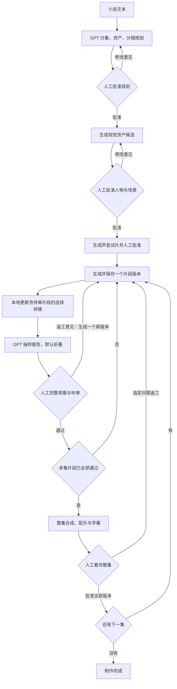

# Nolan 的执行与审批

安装器将程序代码放在独立版本运行目录中，升级不覆盖旧进程使用的代码。新版验证成功后才原子替换各启动命令的符号链接；数据、GPT 登录和会话继续使用原目录。重新安装同一版本也会新建运行目录，旧目录保留供尚未退出的进程使用。升级保留项目暂停状态，不自动恢复制作；明确继续时，已提交的任务按原 ID 查询。

Nolan 以原生 Codex 终端作为 GPT 对话入口，以本机 Python 程序执行制作流程。GPT 可以先自由讨论、写作和修改，决定制作后再调用 Nolan MCP 工具。官方媒体接口生成素材，FFmpeg 执行抽帧、拼接、字幕和混音。终端工具与本地审片页面共享同一份制作状态。

## 对话与制作的边界

`nolan` 不再自动进入最近的演示项目，也不把普通消息送入固定意图分类器。原生会话提供流式输出、多轮上下文与恢复；`nolan --resume` 恢复当前连接下最近的 Nolan 会话。`nolan console` 仅保留旧流程控制台，用于显式的离线演示与兼容。

ChatGPT 订阅与 OpenAI API 使用两个独立的 `CODEX_HOME`。配置只继承用户模型与推理强度，不继承全局 MCP、插件、hooks 或技能。订阅认证通过符号链接复用现有登录，只有官方 CLI 会读取并正常刷新它；API 登录由官方 CLI 从 stdin 接收密钥并保存到独立目录，Nolan 不解析认证内容。切换连接需要 `nolan setup`，运行中的会话保持启动时的连接。模型不自行改变连接或计费方式。

MCP 仅提供项目查询、文本读取、创建项目、保存待审规划、运行/暂停、申请返工、字幕更正、打开审片页与保存创作要求。小说分页读取；创建项目保存完整原文。模型不能调用审批、提高预算、对账或任意 shell。普通文件写入受只读沙箱与禁止升级权限的设置限制，受控制作写入由 MCP 的固定接口执行。Code Mode 只用于调用已提供的工具，必须启用其配套 host；它不会因此获得 shell 权限。

计划、资产、每个视频片段与成片的批准由用户在本机审片页或独立 CLI 操作。GPT 检查只提供报告，不能批准片段或据此自动返工。`save_plan` 严格拒绝状态、文件路径、审批和预算字段；新计划只进入待审批状态。自由 GPT API 对话的费用独立于制作预算；制作流程内部的 API GPT 调用必须先预留 `caps.llm`，未设置预算就停止。显式固定为直接 OpenAI API 的旧项目与订阅选择冲突时也会停止，避免静默付费。

## 从小说到逐集交付

没有声音资产的无对白项目无需声音试片。涉及对白时，默认要求镜头引用已批准的声音资产。规划生成与付费制作分开：批准某集意味着允许进入下一集，程序不会在上一集等待审批时预生成后续集。

## 模块边界

| 模块 | 职责 |
| --- | --- |
| `interactive.py` | 原生 Codex 对话、独立配置与认证目录、会话恢复、工具能力限制。 |
| `connection.py` | 用户选择订阅/API、官方 CLI 登录、连接持久化和制作计费方式绑定。 |
| `mcp_server.py` | GPT 到制作状态机的固定工具接口、参数校验、后台工作和人工审片入口。 |
| `core.py` | 原子状态写入、文件哈希、版本审批、依赖失效、预算账本与进程锁。 |
| `brain.py` | Codex CLI / OpenAI API 调用、结构化输出校验、小说规划、提示词细化、抽样画面审查及对话意图。 |
| `providers.py` | Ark 图片与视频接口、参考素材编码、视频任务查询及下载。 |
| `music.py` | 火山独立纯音乐接口的签名、提交、查询及下载。 |
| `transcription.py` | 从实际音轨取得自动识别文本和时间戳，不使用剧本冒充转写。 |
| `media.py` | 本地 FFmpeg 操作、证据提取、顺序拼接、配乐混音及字幕渲染。 |
| `pipeline.py` | 恢复原任务、推进到下一人工审批点、按人工意见生成一个新版本、粗剪和整集交付。 |
| `dashboard.py` | 仅本机访问的审片界面和操作入口。 |

程序不要求浏览器操纵即梦网页。默认 GPT 通过已有 Codex 登录；独立 OpenAI API 方式由用户显式选择并单独计费。用户的小说、意见和外部文本作为创作数据处理，不获得执行命令或改写审批规则的权力。

原生对话和 MCP 配置依据 [OpenAI 官方 MCP 文档](https://learn.chatgpt.com/docs/extend/mcp?surface=cli)；认证方式依据 [OpenAI 官方认证文档](https://learn.chatgpt.com/docs/auth)。

## 参考条件如何传递

规划里的 `asset_ids` 是镜头到角色、场景、道具或声音资产的绑定。视觉资产经过人工批准后，其真实文件会编码传入 Ark；不能只在提示词里写一个文件名就声称使用了参考图。

声音资产采用原生视频生成的短试片：先用已批准的角色视觉参考生成试音，再提取音轨供人工试听。后续含对白镜头引用已批准声音。视频适配器限制最多 9 张参考图、3 份声音参考，声音参考总计不超过 15 秒；超长时从批准音频开头派生不变速的参考片段，保留原件与实际片段的哈希和时长。不得静默省略角色；数量过限或派生校验失败会停止。

同场景续镜还包含前段实际片尾附近采样画面。GPT 得到资产定义与版本、上一段已观察末态、人工决定、分镜意图和返工意见，然后细化下一段提示词。原定对白作为约束再次附加。未被人工接受的候选不能推进；已人工通过的实际前段作为接续基准，即使旧 GPT 报告曾判失败。报告中的疑点不等于用户逐项证实了错误，后段不应擅自纠正用户已经接受的实际状态。

人物身份设定和画面中的动态状态分开：衣服、角色外貌等来自批准资产；动作位置等来自已接受画面的观察。参考并不等于模型保证，特别是遮挡、复杂运动、多人对白和口型仍容易出错。

## 检查结果不是交付批准

| 结果 | 含义 |
| --- | --- |
| 生成完成 | 收到并保存文件，不能推出内容正确。 |
| `accepted` 片段 | 用户批准当前版本与哈希，可作为后续连续性参考；GPT 的 `pass` 不代替批准。 |
| `review_required` | 当前生成版本等待人工决定，GPT 报告可以是 `pass`、`fail` 或 `uncertain`。 |
| `awaiting_review` 分集 | 整集已有成片，等待完整人工观看和听审。 |
| `approved` 分集 | 人批准当前版本与哈希，允许进入下一集。 |

旧单段抽取首、中、片尾附近画面，带 `subshots` 的片段还按内镜头与切点抽样，并记录原视频 SHA-256。原音频另存为 WAV，但音频文件存在不表示 GPT 已经听过。检查记录明确保留 `audio_checked=false`、`whole_video_checked=false`；抽样通过不能覆盖片段中未采样部分。每个版本都需要用户完整观看与听审。

累计拼接与审批分开。当前视频落盘并完成媒体与抽样证据检查后，先更新本地预览，再请求该片段的 GPT 报告。预览选择从本集第一段开始的最长可用连续前缀，可包含待审批候选和保留待复核的后续片段；缺失视频、正在替换的版本或不匹配的文件不能用历史素材补齐。只有一个可用片段时，直接使用单段播放器。

每份拼接记录明确引用片段 ID、版本与 SHA-256；源视频变化时登记新预览并保留旧文件。是否包含未审批片段由当前人工决定推导，不能把“已经拼好”当作已经验收。返工新版与原本保留的后续视频一起进入当前最长预览，便于人工检查两侧接续。更新预览只执行本地 FFmpeg，不提交视频生成，也不额外请求 GPT。

GPT 粗剪检查仍按 `batch_size` 在原有流程节点触发。已有检查绑定所用片段哈希，素材变化后旧结果不能替代新检查。单段和粗剪报告在网页默认折叠，均只提供建议，不触发视频自动返工，也不自行撤销用户的批准。报告区分关键叙事、身份与明显空间问题，可接受细节，以及待核实项；每项须说明可见证据，不能把缺少证据当成生成错误。

报告调用失败时，保存 `uncertain` 与 `report_unavailable` 占位记录，保留视频供人工审看。已保存的报告或占位记录与当前视频绑定，继续不会自动再次请求；暂停中断则保留暂停状态。粗剪报告也不能代替或撤销单段的人工决定。

## 版本与返工

资产、镜头、成片都使用新的版本文件名。审批包含对象 ID 与当前版本，并核对文件哈希；页面过期、素材丢失或内容改变时不能批准旧结果。

单段返工与整集指定 `shot_ids` 返工都只重新生成明确选中的片段。同场景依赖它的后续片段、后续集已有视频会保留，并转入人工衔接复核；已合成的旧成片失效，须使用最终确认的片段重新合成。空 `shot_ids` 表示本集全部片段返工。改变资产仍会使使用该资产的片段及相关后续产物失效。旧文件与历史记录留作追溯，不会被新结果悄悄覆盖。

每次明确的人工片段返工授权一次新视频提交；得到新版本后再次等待审批。继续或恢复不能因为 GPT 报告失败而追加请求，未知提交结果始终需要先核实。`max_attempts` 限制资产（含声音试片）的累计生成尝试，也限制同一版音轨和转录配置的字幕转录尝试；不再用于触发或限制视频片段的人工返工次数。项目总预算和 GPT 调用次数上限仍然生效。审批针对具体版本，不是永久允许模型自行换角、改场景或批准之后所有集。

片段返工实际调用整段视频生成，当前没有局部编辑、遮罩修补、精确纸面文字排版或透视跟踪合成工具。GPT 的 `repair_prompt` 是供人选择的建议；需要其他后期工具时必须说明尚未执行，不能把建议当成已有修复能力或追加付费请求的授权。

## 费用与恢复

`project.json` 中的每次调用先写入 `reserved`，随后才发送请求。执行过程使用独立运行锁，防止两个进程同时推进制作；状态变更通过短事务锁和原子替换保存。

| 账本类别 | 本地控制含义 |
| --- | --- |
| `reserved` | 已登记、尚未确定完成的调用，占用预算。 |
| `spent` | 已结束调用的保守预算占用；不等于实际扣费。 |
| `unknown` | 请求是否被接受或收费无法确认，继续占用预算并阻止新提交。 |
| `released` | 经核实释放的预留，不再占用预算。 |

可用预算为 `limit - spent - reserved - unknown`。视频按请求秒数乘配置单价上限预留，图片、GPT、音乐分别按配置预留；币种必须一致，不自动换汇。供应商失败仍可能收费，因此程序保守记账，不自动当作免费重试。

用量、公开价格快照和已核对账单保存在各调用的 `billing` 中，分别汇总 `usage_cost` 与 `actual_cost`；缺失值保持未知。账单导入要求逐调用依据，不能由账户总额推算。预算占用取原上限、用量金额和核实金额中的最大值，避免核对费用时放松预算保护。

已保存供应商任务 ID 时恢复运行查询原任务；下载失败只重试取回同一任务。进程在提交阶段退出且没有任务 ID 时转为 `unknown`，需要去供应商控制台核实后对账。人工暂停阻止新的工作，不承诺取消已经在远端执行的任务。

本地预算不能保证供应商账单绝不超出填写金额。模型定价、分辨率、音视频参考等可能影响实际费用；应同时设置服务商消费限制，并先验证一小段。程序不保存密钥到项目状态，也不会将 API 凭据附加到媒体下载请求。

## 音乐和字幕的位置

分镜规划包含音乐意图，成片统一使用连续音乐素材做混音。镜头生成提示词要求不带画面字幕和背景配乐，但模型是否遵守仍需审片。不能假定原生混音可以自动还原成独立声部。

字幕基于最终音轨的时间戳，转写是独立步骤。计划对白与真实识别文本不一致时应作为审片问题，不能把两者直接视作相同。修改镜头时长、顺序或对白后，旧字幕时间线需要更新。自动转写也可能错字、漏词或错分说话人，不能替代最终校对。

字幕转写缓存绑定镜头顺序、内容哈希、转写模型和语言，缓存结果还需匹配登记哈希。纯文字纠错保留镜头与原时间戳，仅产生新的成片版本，再次等待审批。文字纠错请求也绑定镜头哈希；排队期间如果镜头改变，旧时间线上的修改不能套到新片段。未知计费结果不会被缓存缺失当作自动重试许可。

## 数据范围

| 目录 | 内容 |
| --- | --- |
| `source/` | 小说原文。 |
| `plans/` | 各版分集和资产规划。 |
| `media/` | 视觉资产、试音、分镜视频及音乐。 |
| `evidence/` | 抽帧、音轨和检查证据。 |
| `exports/` | 滚动粗剪、各版成片及字幕。 |

运行目录应保存在自己的本地存储或备份位置，避免将未授权小说和生成素材推入代码仓库。项目的私有 GitHub 仓库保存程序；本地制作目录保存每一部作品。没有自动公开发布成片的步骤。
